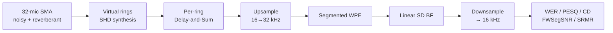
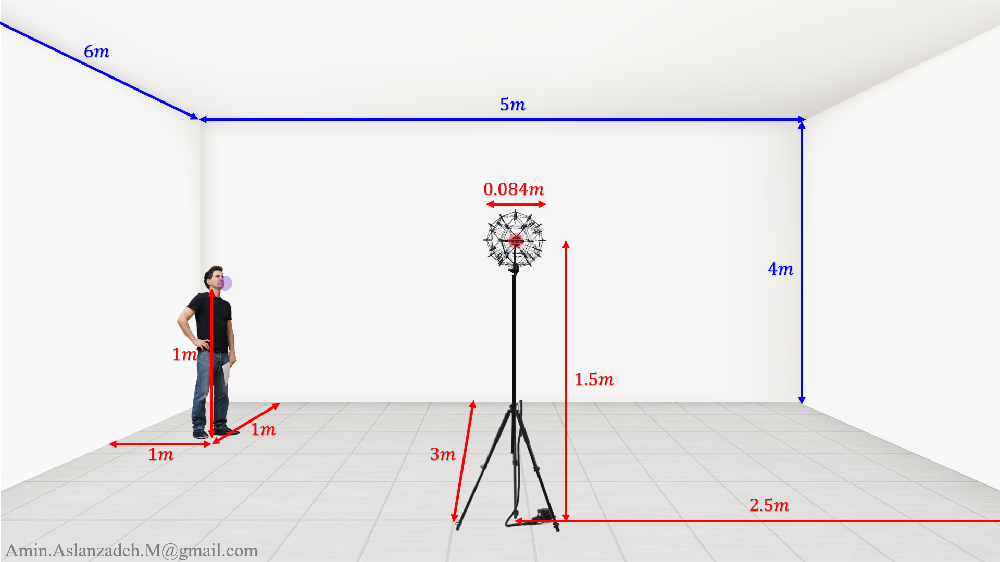
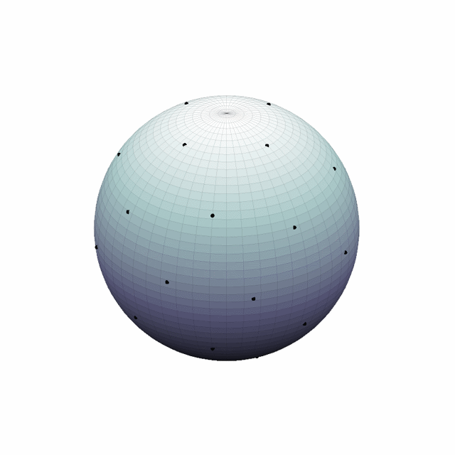
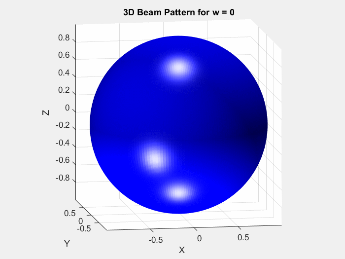

# Spherical-Array Speech Enhancement

Companion code for the manuscript:

> **Speech Enhancement in Human–Machine Interaction in Noisy Reverberant Environments Using a Spherical Array with a Variable Number of Microphones**

This repository provides the **simulation setup**, **method scripts** aligned with the paper tables, **objective metrics**, and **example audio samples** used in the experimental evaluation.

> For the exact paper ↔ script mapping (Tables 2–3), see **[PAPER_CODE_MAP.md](PAPER_CODE_MAP.md)**.

---

## Overview

The proposed pipeline (**CA2LA-BFnet / Proposed**) enhances speech captured by a 32-microphone open spherical array in noisy reverberant rooms. It combines:

1. Spherical-harmonic synthesis of **virtual microphones on parallel rings**
2. Per-ring **Delay-and-Sum** (directional virtual mics / MIMO layer)
3. **Upsampling** (16 kHz → 32 kHz) to support denser ring packing
4. **Segmented WPE** dereverberation on ring outputs
5. Linear **Superdirective** beamforming (MISO layer)
6. Downsampling back to 16 kHz for ASR / metric evaluation

Baselines and ablations reported in the paper (USMA-DS, USMA-SD, USMA-BF, NEW-USMA-BF, USMA-WPE, NEW-USMA-WPE, USMA-WPE-BF) are included under `01_src/methods/`.



---

## Visual demo

A compact showcase of the geometry and beamforming behavior.  
**Full gallery** (all GIFs, method comparisons, outlook, audio links): **[docs/demo.md](docs/demo.md)**  
**Where to drop media files:** **[docs/COPY_GUIDE.md](docs/COPY_GUIDE.md)**

<p align="center">
  
</p>
<p align="center"><sub>Experimental scenario — talker / source and spherical array in a reverberant room.</sub></p>

<p align="center">
  
  &nbsp;&nbsp;
  
</p>
<p align="center"><sub>Left: 32 physical microphones (R = 4.2 cm). Right: Proposed method beam pattern (0–4000 Hz).</sub></p>

### Listen (R = 4.2 cm)

| Method | Before | After |
|---|---|---|
| **Proposed** | [before.wav](05_results/Proposed/radius_4_2cm/before.wav) | [after.wav](05_results/Proposed/radius_4_2cm/after.wav) |
| USMA-WPE-BF | [before.wav](05_results/USMA_WPE_BF/radius_4_2cm/before.wav) | [after.wav](05_results/USMA_WPE_BF/radius_4_2cm/after.wav) |

> Full gallery: **[docs/demo.md](docs/demo.md)** · Copy guide: **[docs/COPY_GUIDE.md](docs/COPY_GUIDE.md)**

---

## Repository layout

```text
spherical-array-speech-enhancement/
├── docs/                   # Visual gallery + media copy guide
│   ├── demo.md             # Full figure / GIF / audio gallery
│   ├── COPY_GUIDE.md       # Exact filenames for each asset
│   └── figures/            # Scenario, geometry, beam-pattern GIFs
├── 00_simulation/          # SMIR RIR generation + dataset construction
│   ├── smir_generator/     # Habets SMIR + project configuration
│   ├── dataset_generation/ # RIR crop, convolution, AWGN @ 10 dB SNR
│   └── rir_samples/        # Small illustrative RIR / mic-signal samples
├── 01_src/
│   ├── math/               # Spherical harmonics, Bessel, geometry helpers
│   ├── plot/               # Array / pattern visualization
│   └── methods/            # Paper methods & ablations (by name + radius)
├── 03_metrics/
│   ├── array_performance/  # Beam pattern / DF / WNG related scripts
│   └── speech_quality/     # WER, PESQ, CD, FWSegSNR, SRMR
├── 04_third_party/         # WPE (FDNPL) package used by the pipeline
├── 05_results/             # Example before/after WAV samples (qualitative)
├── PAPER_CODE_MAP.md       # Table ↔ script index (start here for reviewers)
├── CITATION.cff
└── LICENSE
```

---

## Experimental setup (paper Sec. 4)

| Parameter | Value |
|---|---|
| Room | 6 × 5 × 4 m |
| RT60 | 1 s |
| Array center | (3.0, 2.5, 1.5) m |
| Source | (1.0, 1.0, 1.0) m |
| Speed of sound | 343 m/s |
| Array radii | **4.2 cm** and **10 cm** |
| Physical microphones | 32 (open Platonic layout) |
| Sampling rate | 16 kHz (TIMIT); Proposed path uses 32 kHz internally |
| Noise | AWGN ≈ 10 dB SNR |
| Spherical-harmonic order | *N* = 4 (virtual-mic synthesis) |
| Evaluation set | 400 utterances (20 female + 20 male speakers × 10) |
| Primary metric | **WER** (WeNet 2.0) |
| Secondary metrics | PESQ, FWSegSNR, CD, SRMR |
| Array metrics | Beam pattern, DF, WNG |

---

## Quick start

### 1. Requirements

- **MATLAB** (developed with R2024a) + Signal Processing Toolbox  
- **MinGW-w64** (or another MATLAB-supported C++ compiler) for SMIR MEX builds  
- **Python 3** + Jupyter (WER / PESQ)  
- External toolboxes used by metrics / third-party code:
  - [SMIR Generator](https://github.com/ehabets/SMIR-Generator) (vendored under `00_simulation/smir_generator/`)
  - WPE / FDNPL (under `04_third_party/WPE_FDNPL/`)
  - [WeNet](https://github.com/wenet-e2e/wenet) (WER notebook)
  - [python-pesq / pypesq](https://github.com/vBaiCai/python-pesq)
  - [MuSAE Lab SRMRToolbox](https://github.com/MuSAELab/SRMRToolbox) (for SRMR)

### 2. Simulate RIRs

```matlab
cd 00_simulation/smir_generator/custom_zaviyun
run_simulation   % set sphRadius to 0.042 or 0.1 as needed
```

### 3. Build the 400-utterance microphone dataset

Provide clean TIMIT utterances locally, then:

```matlab
cd 00_simulation/dataset_generation
prepare_dataset
```

> Full TIMIT / 400-file corpora are **not** redistributed here (license + size).  
> Small illustrative RIRs and mic signals are in `00_simulation/rir_samples/`.

### 4. Run a paper method

Open the script listed for your condition in [PAPER_CODE_MAP.md](PAPER_CODE_MAP.md), for example:

```matlab
cd 01_src/methods/Proposed/radius_4_2cm
T400_SuperDirective_On_rings_withWPE_R_4v2_Upsampling
```

**Important:** many experiment scripts still contain absolute `path(...)` / `saveDir` entries from the original lab machine. Before a full batch run, update those paths to your local data and output folders (search for `D:/ARTICLE` and `saveDir`).

### 5. Evaluate

| Metric | Entry point |
|---|---|
| WER | `03_metrics/speech_quality/WER/WeNet_ASR_WER_Evaluation.ipynb` |
| PESQ | `03_metrics/speech_quality/PESQ/run_pesq_evaluation.py` |
| CD | `03_metrics/speech_quality/CD/run_cd_evaluation.m` |
| FWSegSNR | `03_metrics/speech_quality/FWSegSNR/run_fwseg_evaluation.m` |
| SRMR | `03_metrics/speech_quality/SRMR/run_srmr_evaluation.m` |

Each metric folder has its own README with dependencies and I/O conventions.

### 6. Listen to example outputs

```text
05_results/<METHOD>/radius_4_2cm/{before,after}.wav
05_results/<METHOD>/radius_10cm/{before,after}.wav
```

---

## Method index (high level)

| Paper name | Role | Folder |
|---|---|---|
| No Proc | Unprocessed closest-mic reference | built in `00_simulation/dataset_generation/` |
| USMA-DS | Spherical Delay-and-Sum | `01_src/methods/USMA_DS/` |
| USMA-SD | Spherical Superdirective | `01_src/methods/USMA_SD/` |
| USMA-BF | Baseline rings + SD (no WPE, no upsample) | `01_src/methods/USMA_BF/` |
| NEW-USMA-BF | Proposed without WPE (with upsample) | `01_src/methods/NEW_USMA_BF/` |
| USMA-WPE | Rings + WPE only | `01_src/methods/USMA_WPE/` |
| NEW-USMA-WPE | Upsampled rings + WPE only | `01_src/methods/NEW_USMA_WPE/` |
| USMA-WPE-BF | Full baseline | `01_src/methods/USMA_WPE_BF/` |
| **Proposed** | Full method (upsample + WPE + SD) | `01_src/methods/Proposed/` |

Canonical per-radius scripts, ring counts, and regularization notes are documented in **[PAPER_CODE_MAP.md](PAPER_CODE_MAP.md)**.

---

## Reproducibility notes

- Scripts are **experiment drivers** used to generate the reported results, not a packaged toolbox API.
- Intermediate artifacts (virtual-ring WAVs, WPE outputs, weight matrices) are produced on disk by the batch scripts; keep directory layout consistent with each script’s expectations.
- Array metrics (beam pattern / DF / WNG) may appear both inside method scripts and under `03_metrics/array_performance/`.
- Binary MEX files, if present, are Windows-oriented; rebuild from the included `.cpp` sources on other platforms.

---

## Citation

Please cite this repository for now. A formal paper citation (venue, year, DOI) will be added after publication.

```bibtex
@software{aslanzadeh_spherical_array_speech_enhancement,
  title   = {Spherical-Array Speech Enhancement --- Companion Code},
  author  = {Aslanzadeh, Amin and Kanani, Maedeh},
  url     = {https://github.com/zaviyun/spherical-array-speech-enhancement},
  note    = {Companion code for: Speech Enhancement in Human--Machine Interaction in Noisy Reverberant Environments Using a Spherical Array with a Variable Number of Microphones}
}
```

See also [`CITATION.cff`](CITATION.cff).

---

## Third-party acknowledgements

This work builds on publicly available research software, including:

- E. A. Habets — [SMIR Generator](https://github.com/ehabets/SMIR-Generator)
- WPE / FDNPL package (see `04_third_party/WPE_FDNPL/`)
- Philipos C. Loizou — CD / FWSegSNR MATLAB routines
- WeNet ASR toolkit; `python-pesq`; MuSAE Lab SRMRToolbox

Please respect the original licenses of redistributed third-party components.

---

## License

Original project code is released under the [MIT License](LICENSE).  
Third-party code retains its respective licenses.

---

## Contact

- Amin Aslanzadeh — `Amin.Aslanzadeh.M@gmail.com`

Questions about mapping a paper table row to a script are best answered by starting from [PAPER_CODE_MAP.md](PAPER_CODE_MAP.md).
