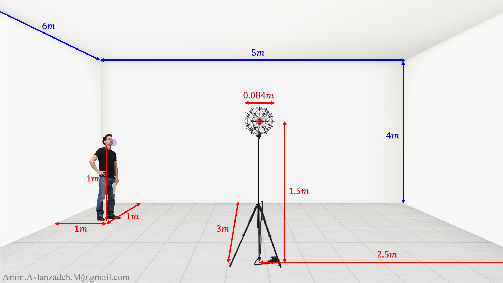
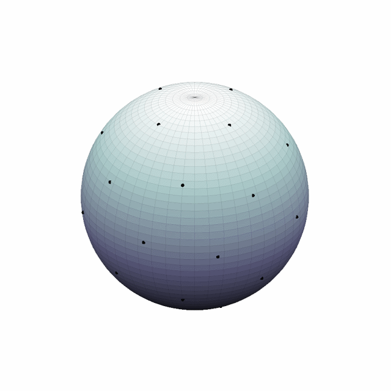
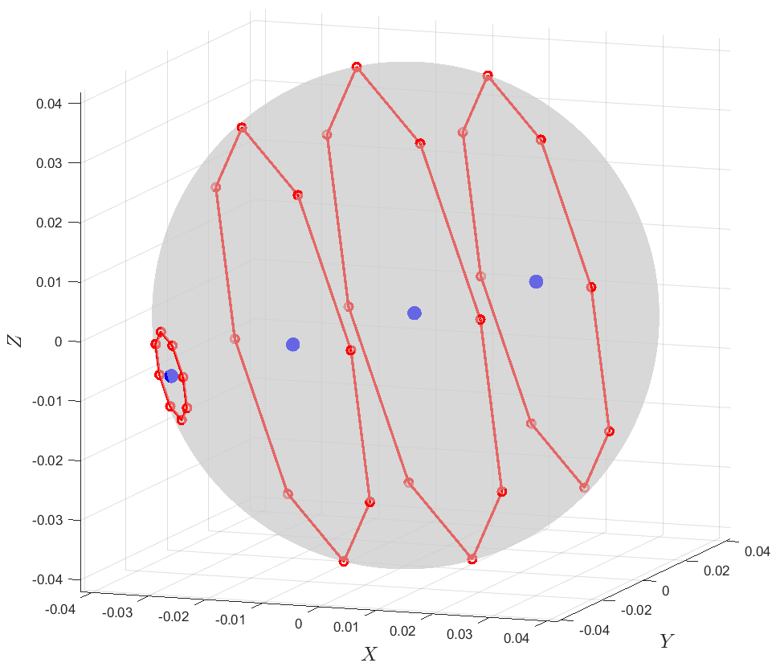
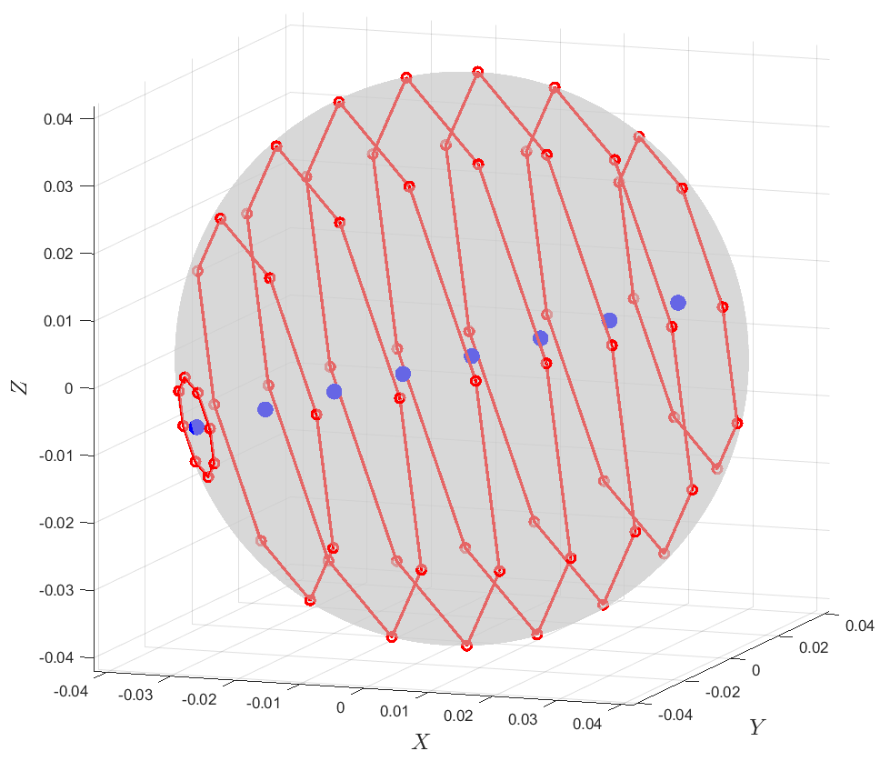
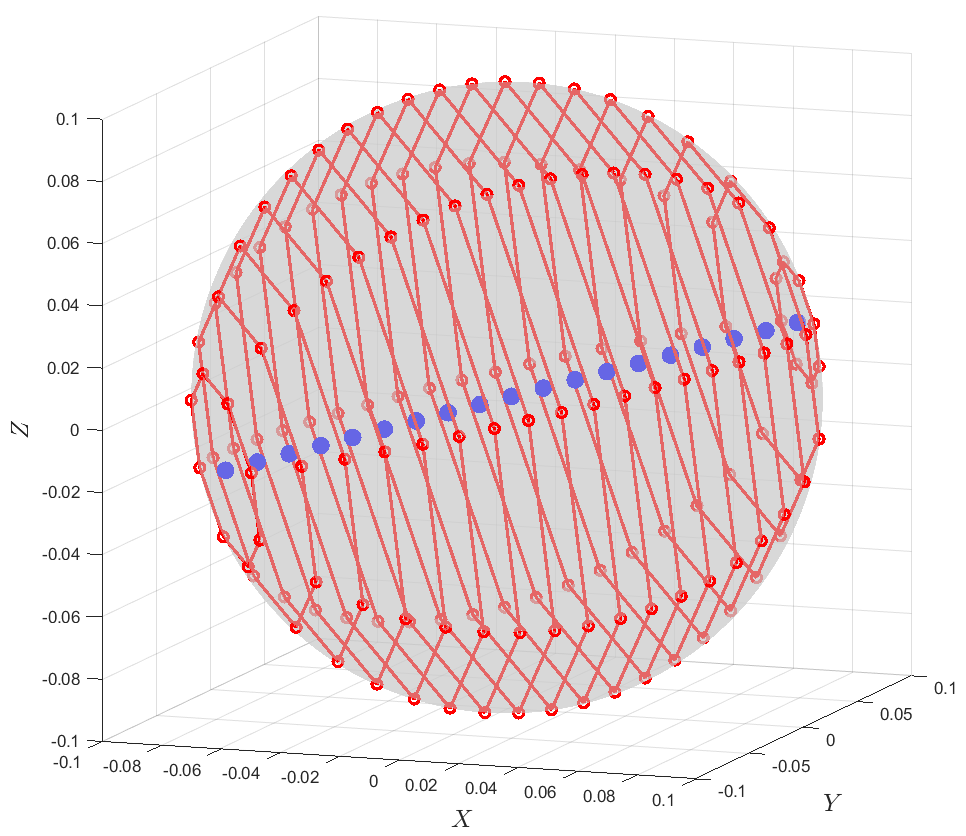
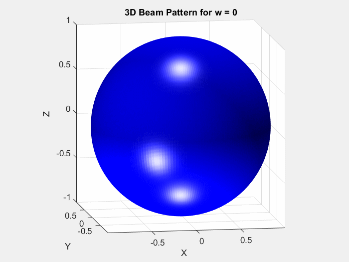
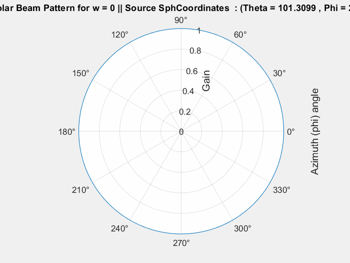
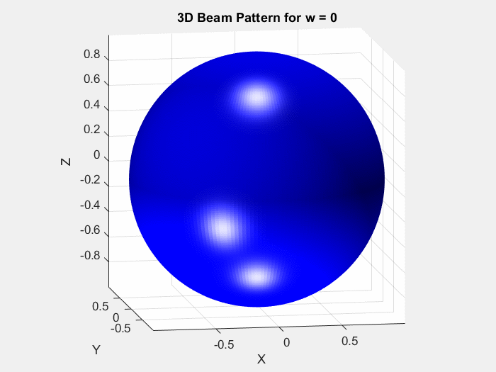
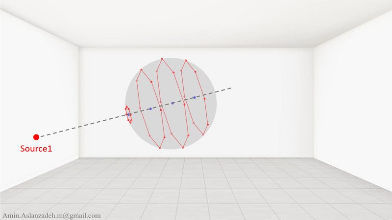

# Visual Demo Gallery

Interactive overview of the geometry, beam patterns, listening examples, and outlook visuals for this project.

> Media files live under [`figures/`](figures/).  
> Exact copy instructions: [`COPY_GUIDE.md`](COPY_GUIDE.md).  
> Paper ↔ script mapping: [`../PAPER_CODE_MAP.md`](../PAPER_CODE_MAP.md).

---

## Contents

1. [Experimental scenario](#1-experimental-scenario)
2. [Array geometry](#2-array-geometry)
3. [Single-microphone beam patterns](#3-single-microphone-beam-patterns)
4. [Ring responses after Delay-and-Sum](#4-ring-responses-after-delay-and-sum)
5. [Method comparison](#5-method-comparison)
6. [Listening examples](#6-listening-examples)
7. [Outlook](#7-outlook-potential-future-applications)

---

## 1. Experimental scenario

Room / source / spherical-array placement used in the simulated evaluation.

  

Figure: noisy reverberant room with talker and 32-microphone open spherical array.

---

## 2. Array geometry

### 2.1 Physical array (R = 4.2 cm)

  

32 physical microphones on an open sphere (R = 4.2 cm).

### 2.2 Virtual parallel rings

Upsampling increases the number of admissible parallel rings for a given sphere radius.

| Radius | Without upsampling | With upsampling |
|---|---|---|
| **4.2 cm** |  |  |
| **10 cm** |  |  |

---

## 3. Single-microphone beam patterns

Frequency sweep **0 → 4000 Hz**, array radius **R = 4.2 cm**.

### Physical microphone

| 2D | 3D |
|---|---|
|  |  |

### Virtual microphone on a ring

| 2D | 3D |
|---|---|
|  |  |

---

## 4. Ring responses after Delay-and-Sum

Directional virtual-microphone outputs after per-ring Delay-and-Sum (**R = 4.2 cm**, **0 → 4000 Hz**).

### Ring 2

| 2D | 3D |
|---|---|
|  |  |

### Ring 3

| 2D | 3D |
|---|---|
|  |  |

---

## 5. Method comparison

Beam patterns for selected paper conditions (**R = 4.2 cm**, **0 → 4000 Hz**).

### USMA-DS

| 2D | 3D |
|---|---|
|  |  |

### USMA-SD

| 2D | 3D |
|---|---|
|  |  |

### USMA-WPE-BF

| 2D | 3D |
|---|---|
|  |  |

### Proposed

| 2D | 3D |
|---|---|
|  |  |

---

## 6. Listening examples

GitHub Markdown strips `<audio>` tags, so players are on a real HTML page:

**[▶️ Open audio players](https://zaviyun.github.io/spherical-array-speech-enhancement/docs/listen.html)** · [`listen.html`](listen.html)

Qualitative `before` / `after` download links (not a substitute for the paper tables):

| Method | R = 4.2 cm | R = 10 cm |
|---|---|---|
| Proposed | [before](../05_results/Proposed/radius_4_2cm/before.wav) · [after](../05_results/Proposed/radius_4_2cm/after.wav) | [before](../05_results/Proposed/radius_10cm/before.wav) · [after](../05_results/Proposed/radius_10cm/after.wav) |
| USMA-WPE-BF | [before](../05_results/USMA_WPE_BF/radius_4_2cm/before.wav) · [after](../05_results/USMA_WPE_BF/radius_4_2cm/after.wav) | [before](../05_results/USMA_WPE_BF/radius_10cm/before.wav) · [after](../05_results/USMA_WPE_BF/radius_10cm/after.wav) |
| USMA-SD | [before](../05_results/USMA_SD/radius_4_2cm/before.wav) · [after](../05_results/USMA_SD/radius_4_2cm/after.wav) | [before](../05_results/USMA_SD/radius_10cm/before.wav) · [after](../05_results/USMA_SD/radius_10cm/after.wav) |
| USMA-DS | [before](../05_results/USMA_DS/radius_4_2cm/before.wav) · [after](../05_results/USMA_DS/radius_4_2cm/after.wav) | [before](../05_results/USMA_DS/radius_10cm/before.wav) · [after](../05_results/USMA_DS/radius_10cm/after.wav) |

More conditions: [`../05_results/`](../05_results/).

> Enable GitHub Pages (**Settings → Pages → Deploy from `main` / root**) so the online player URL works.

---

## 7. Outlook (potential future applications)

The items below are **illustrative extensions**, not evaluated claims of the current manuscript. Source location was known in the paper experiments; localization / multi-source tracking are future directions enabled by the same parallel-ring idea.

### Multi-source enhancement / separation

Parallel rings steered toward different sources can, in principle, enhance one talker while attenuating others simultaneously.

  

### Drone tracking without mechanical radar rotation

The same spatially flexible virtual-ring construction suggests a path toward electronic spatial scanning for tracking applications.

  

---

  <b>Back to</b> <a href="../README.md">README</a> · <a href="../PAPER_CODE_MAP.md">Paper ↔ Code Map</a>

